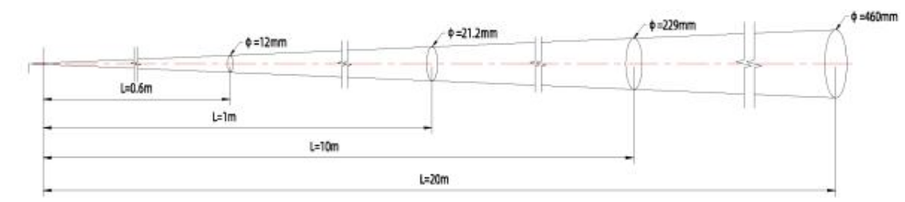
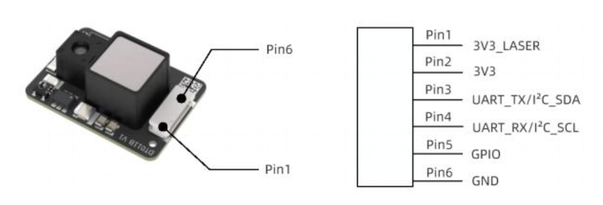
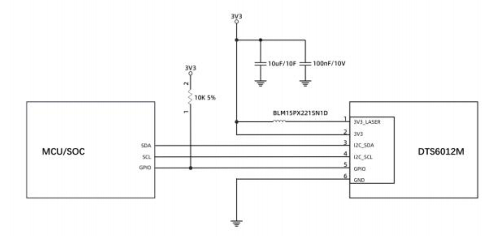

# dts6012m-i2c-esphome
Custom ESPHome component for the DTS6012M time-of-flight distance sensor using its I2C interface.

Most of the code is generated by ChatGPT-4 based on the sensor's datasheet and ESPHome documentation. I didn't bother with so many details, so tread carefully and test thoroughly before using it. This is just a hobby project I bashed by my forehead on the keyboard until I made it work.

Build-validated with the `denky32` target, Arduino framework, and ESPHome 2025.9.3. Physical sensor reliability still needs verification on a stable power supply; successful compilation and simulated tests do not establish hardware reliability.

### Distance Cone
From documentation:


## ⚙️ Hardware Requirements


**Sensor:** DTS6012M time-of-flight distance sensor

**Microcontroller:** ESP32 with the Arduino framework. One ESPHome I2C bus, using the global Arduino `Wire` instance, is supported.

> [!WARNING]
> Supply both sensor power pins with stable nominal 3.3V, within the specified 3.0-3.6V range, including startup and load transients. Intermittent failed starts and latched readings were observed on an assembly whose laser supply dipped to approximately 3.0V. Supply droop is a suspect, not a confirmed root cause. When using the ESP board's 3V3 output, check its regulator capacity and input headroom under load; the required board input voltage depends on its regulator and power-input circuitry.

**Connections:**

- Sensor Pin 1 (red), **3V3_LASER → regulated 3.3V through the reference ferrite bead**
- Sensor Pin 2 (black), **3V3 → regulated 3.3V**
- Sensor Pin 3 (yellow) **TX → SDA pin** of ESP32
- Sensor Pin 4 (green) **RX → SCL pin** of ESP32
- Sensor Pin 5 (blue) **leave floating or pull up to 3.3V through 4.7k ohms**
- Sensor Pin 6 (white) **GND → GND**



## Wire for I2C Connection


This component targets only the I2C interface of the DTS6012M sensor.

> [!WARNING]
> Leave sensor pin 5 floating or pull it up to 3.3V through 4.7k ohms, as specified by the datasheet. It selects I2C at startup, then becomes a frame-ready output. Never hard-wire it to 3.3V or drive it from an MCU output.

Both sensor supplies must remain within 3.0-3.6V. The reference circuit shows 10uF and 100nF decoupling on the incoming 3.3V rail and a ferrite bead in series with the laser-supply branch (pin 1). Place filtering close to the sensor and use a regulator capable of supplying its transient load. Firmware cannot correct inadequate power. The laser is 905nm infrared; do not look into the aperture.



### Powering over a long cable

A long cable can drop voltage during ESP32 and sensor current bursts. One suitable architecture is a higher-voltage DC supply over the long cable, followed by a local buck converter producing regulated 5V near the ESP board. Select the source voltage and cable for the converter's ratings and required headroom after cable loss; 6V may not be sufficient for every 5V buck.

- Never connect the higher distribution voltage directly to the ESP board or sensor.
- Verify the buck's 5V output, startup overshoot, and loaded voltage before connecting the board. Use the board's documented 5V input, not its 3V3 pin.
- Use short local power/ground connections, common ground, and appropriate source-side cable protection.
- The onboard 3.3V regulator must still support the combined load. A separate local regulated 3.3V sensor supply is an alternative; do not parallel its output with the board's 3V3 output.
- Do not use a Zener diode alone as a 5V-to-3.3V supply, or raise the main voltage blindly to compensate for cable loss.
- Avoid powering through USB and an external 5V input simultaneously unless the board provides suitable isolation.

Measure at the sensor connector, preferably capturing both supply rails during good and failed cold starts. A steady multimeter reading cannot exclude brief dips. The `denky32` build target does not identify the physical board's regulator or establish its allowable VIN range.

## Possible Gotchas
The component uses address `0x51`, defined in [DTS6012M.h](components/dts6012m/DTS6012M.h); it has no YAML address option. The specified measuring range is 0.2-20m. For moving-target checks, use a matte target at 0.5-1m rather than testing at the minimum-range boundary.

# Example ESPHome Configuration
This matches the current [esp32.yaml](esp32.yaml) settings. Deep sleep and external power switching are disabled in this baseline. Adjust pins and secrets as needed.
```yaml
esphome:
  name: dts6012m-node

esp32:
  board: denky32
  framework:
    type: arduino

# Enable logging
logger:
  level: DEBUG
  logs:
    dts6012m: DEBUG

# Enable Home Assistant API
api:
  encryption:
    key: !secret api_encryption_key

ota:
- platform: esphome
  password: !secret ota_password

wifi:
  use_address: !secret ip_address
  ssid: !secret wifi_ssid
  password: !secret wifi_password
  fast_connect: True

  # Enable fallback hotspot (captive portal) in case wifi connection fails
  ap:
    ssid: "LiDAR_Fallback"
    password: !secret wifi_fallback_outside
    # ap_timeout: 1min

i2c:
  sda: 21
  scl: 18
  scan: false
  # optional: lower clock if unstable
  frequency: 10kHz

captive_portal:

external_components:
  - source: ./custom_components
    components: [dts6012m]

dts6012m:
  update_interval: 5s
  retries: 3
  wakeup_time: 20ms
  powerup_time: 250ms
  sleep_between_updates: true
  distance:
    name: "DTS6012M Distance"

sensor:

```

The `external_components` source above uses the repository's components mounted by Docker Compose at `/config/custom_components`. Outside the container, use `./components`. For a remote source, select a GitHub revision containing this implementation; historical tags do not contain these changes.

## Periodic Node Deep Sleep
If you want the whole ESP32 node to wake up, measure, report, and then power down for a while, use ESPHome's `deep_sleep` component:

- `run_duration`
  How long the node stays awake after boot. This must be long enough for Wi-Fi connection, API/OTA startup, and one or more sensor updates.
- `sleep_duration`
  How long the node remains in deep sleep before waking again.

Optional addition to the baseline configuration:

```yaml
deep_sleep:
  run_duration: 30s
  sleep_duration: 30s
```

Practical notes:

- While the node is asleep, it is offline. Home Assistant will not be able to poll it.
- OTA updates only work during the `run_duration` wake window.
- Allow enough awake time for startup settling, the poll interval, ranging warmup, retries, and reporting; asynchronous work is cancelled when the node shuts down.
- For battery-powered operation, deep sleep at the node level is usually much more effective than only trying to idle the sensor.
- The current example does not include a Home Assistant `Prevent Deep Sleep` switch. If you add one, explicitly wire it to ESPHome's `deep_sleep.prevent` and `deep_sleep.allow` actions and decide whether its state should persist across boots.
- A `run_duration` of `10s` can be too short once Wi-Fi association and encrypted API authentication are included. `30s` is a safer starting point.
- Home Assistant normally keeps the ESPHome API connection open while the node is awake, so API connectivity should not be used as the condition for blocking deep sleep.

## Power Saving Behavior
The production component keeps the `v0.1.2` measurement cycle as its default: **START, wait, read, STOP**. Waits and retries use ESPHome scheduler callbacks rather than blocking `delay()` calls. Overlapping polls are skipped while a cycle is pending.

| Setting | Default | Behavior |
|---|---|---|
| `update_interval` | `500ms` | Poll cadence; the checked-in node example uses 5s |
| `retries` | `3` | Total read attempts per cycle, validated from 1 to 10; retries are 10ms apart |
| `wakeup_time` | `20ms` | Asynchronous delay after starting ranging |
| `powerup_time` | `250ms` | Asynchronous settling delay before initial setup, and after each power-pin activation |
| `sleep_between_updates` | `true` | STOP after each cycle; `false` starts once and reads continuously |
| `power_pin` | omitted | Optional active-high power-switch control; takes precedence over standby/continuous selection |

On deep-sleep wake, component setup runs again. Shutdown cancels pending callbacks, attempts to stop ranging, and turns off a configured power switch. The default does not require switched power. A power pin must control a suitable external transistor/load switch, not supply the sensor directly from a GPIO. Switching only the laser rail does not fully reset the logic circuitry; avoid back-powering through I2C when switching an entire module.

Example low-power configuration:

```yaml
dts6012m:
  update_interval: 5s
  retries: 3
  power_pin:
    number: GPIO23
  powerup_time: 250ms
  wakeup_time: 20ms
  distance:
    name: "DTS6012M Distance"
```

## Driver and Failure Handling

The class-based driver uses the [Arduino reference library](https://github.com/fan4tix/DTS6012M)'s register map, probe, big-endian decoding, and millimetre-to-metre conversion. It deliberately keeps the historical STOP-based register selection instead of the reference library's repeated START. ESPHome alone initializes the shared bus; the driver does not call `Wire.begin()` or change pins, clock, or timeouts. Configuration rejects non-Arduino/non-ESP32 targets and multiple I2C buses rather than silently using the wrong bus.

Unlike the reference library, register writes check queued bytes and I2C status, reads check the returned length and buffer contents, and failures never return a success-shaped zero or cached distance. Raw `0xFFFF` is rejected because 65.535m is outside the specified 20m range; its exact firmware-specific error meaning remains unknown. Other values, including repeated stationary readings, are not treated as a freeze.

After exhausted read attempts or a failed START/STOP, the cycle sets an ESPHome warning and publishes `NaN` (unavailable), rather than leaving a previous distance looking current. Standby and power-gated cycles attempt STOP even after failure. The next update retries initialization; recovery clears the warning. There is no repeated-value watchdog, automatic ESP restart, or claim that software can repair a sensor power fault.

Production logging includes the selected mode and timings at CONFIG level, one successful distance summary at DEBUG, and actionable transport/measurement errors at WARN. The temporary `[DTS-DIAG]` trace and blocking boot hook have been removed. I2C calls themselves remain synchronous and bounded by the bus timeout; only settling, warmup, and retry waits are asynchronous.

## Validation

Run `python -B -m unittest discover -s tests -p test_diagnostics.py -v` with a native C++17 `g++` or `clang++` (or set `CXX`). The harness compiles the actual production sources against deterministic Wire and scheduler substitutes. It checks all three power modes, non-blocking waits, overlapping updates, bounded retries, initialization/read/write failures, `0xFFFF`, unavailable publication, subsequent recovery, and shutdown cancellation. When the ESPHome CLI is available, schema tests also validate supported modes and reject unsupported framework, bus, and retry settings; otherwise those schema tests are skipped. These tests do not reproduce physical power faults.

Build the real ESP32 example with `docker compose run --rm esphome compile /config/esp32.yaml`. Before deployment, verify changing distances, prolonged operation, and repeated cold starts on correctly powered hardware. If using node deep sleep, also verify complete sleep/wake cycles.

# Development in Container: Docker Compose
For development purposes, you can use the following `docker-compose.yaml` to set up an ESPHome environment with access to USB devices for flashing and monitoring your ESP32 boards.

For `secrets.yaml`, create a file in the project-root directory with your WiFi and OTA credentials, it will be mounted into the container.

Example of `secrets.yaml`:
```yaml
wifi_ssid: "my_wifi_ssid"
wifi_password: "my_wifi_password1234567"
```

## Tips for Deploying Config to Device
Use Chromium-based browser (Edge, Chrome, Brave, etc.) to access the ESPHome dashboard at `http://localhost:6052` (adjust port as needed). Chromium have serial monitoring built-in, I suppose that's why it is needed for the first flash. Then you can use any browser for OTA updates.

For the first upload wiht wifi credentials to enable the OTA updates, you need to connect the ESP32 via USB to your computer and select the appropriate serial port in the ESPHome dashboard. If you have issues with accessing the serial port from within the container, you can bypass by downloading the compiled binary from the container's ESPHome dashboard (Install > Manual Download > Factory Format > Open ESPHome Web) and flashing it using online-loaded esphome dashboard.

## Troubleshooting Problems during Building
Sometimes the local build cache becomes corrupted, especially when you messed up with some external components. To fix this, you can clear the build cache by deleting the `.esphome/build` folder:
```shell
rm -rf /config/.esphome/build
```
Then try to build again.

Sometimes, esphome downloads and cache the external components and until version is changed, it won't download again. To force re-download of the external components, you can delete the `.esphome/downloads` folder:
```shell
rm -rf /config/.esphome/external_components
```
Then try to build again.